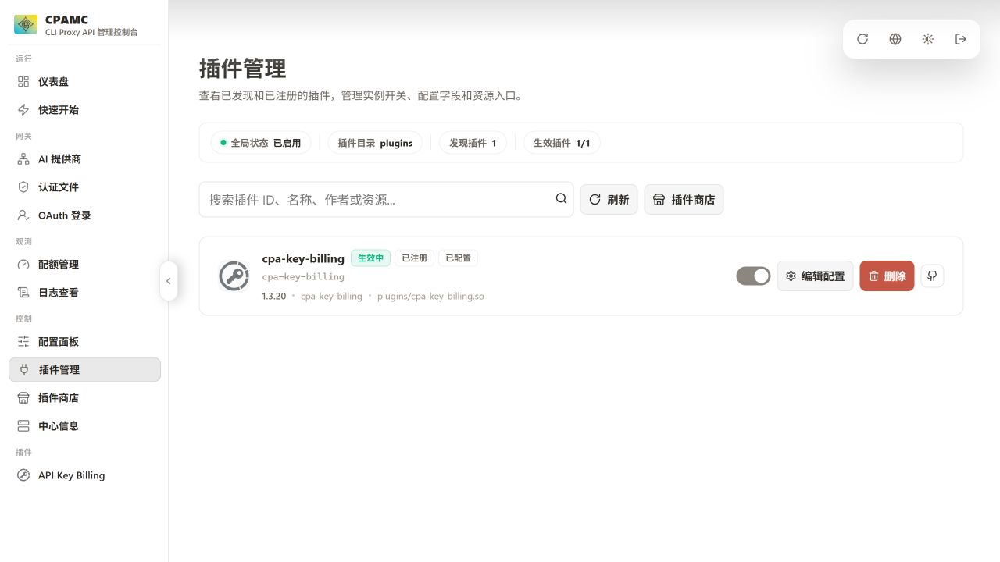

# CPA 8.0.23 手动插件安装与总控配置兼容验收

日期：2026-10-12（Asia/Taipei）。用户授权的 Ubuntu 22.04 amd64 测试机；总控由当前工作区源码构建为 Linux SEA 包，通过项目发布安装脚本部署。

本次实测发布二进制已取回到 release/multi-cliproxyapi-linux-x64，SHA-256：`48226bcc26bd02582aecd7dea5e151d3e8d256c5942978cc46e71d40f7e11a76`。发布二进制由 gitignore 排除，不随源码提交。

## 实际流程与根因

CPA 8.0.23、commit d318bcc3，与用户日志一致。插件 cpa-key-billing 1.3.20。实例 cpa-812f1d284bb14a0ba06d，端口 18322。

总控 API 创建实例；真实浏览器登录 CPA 并打开插件商店；在子实例目录运行指定插件安装脚本、修改插件目录属主、通过总控重启。在面板启用插件后，它变为已注册、生效中，API Key Billing 内嵌页面可打开。

安装前后配置 SHA-256 均为 `6e67ebb26b8259e03ff12d0be205275395efd82b458e0921667504f323a8b960`。脚本没有修改配置；在管理面板启用插件后，CPA 才将配置保存为四空格缩进的 v8 格式，并增加 plugins.configs。

用 git show e60f68d:server/services.js 取得旧 ensureManagementConfig，对真实 v8 文件调用，再实际重启子服务。旧方法插入顶层 host、旧版 remote-management 和第二个不同缩进的 plugins.enabled；CPA 报 `yaml: line 6: did not find expected key`，MainPID=0、ActiveState=inactive。这里只回放旧配置方法，未部署完整旧总控包。随后立即恢复合法配置。本次多了 plugins.configs，因此报错行号与用户的第 3 行不同，机制相同。

## 修复版结果

9 项通过，详见 results.json：插件注册生效；连续三次子实例重启保持配置不变；总控重启保持子实例 PID 和配置；停止后总控重启仍停止；重新启动已停止实例；修改 v8 server.port 后插件和管理 API 正常；修改 management.secret-key 后新密码成功、旧密码 401；总控报告 running 且 management_ready；临时桥接拒绝非测试服务命令。

端口与管理密码修改后恢复测试值。真实 Linux 后端全量测试：113 通过、0 失败、0 跳过。没有上游 OAuth 或模型凭证，未验证真实模型消费、计费金额或额度扣减。

## 环境限制

服务器 GitHub 匿名 API 返回 rate limit exceeded；本轮商店仍显示 114 个注册表条目，不能声称商店整体加载失败。CPA 官方归档 SHA-256 `744000a1a4f9ce19f5964774f853d029797b87ef533796d054389258c66cb1224` 与官方 checksums.txt 一致。插件使用安装脚本自带校验，无 GitHub Token。

Ubuntu 22.04 的 polkit 0.105 未执行项目 JavaScript 规则，总控起初不能启动子实例。这是独立的生产部署兼容问题，本次未修复，不能把本次测试当作旧版 polkit 授权规则通过。

经用户明确授权，临时桥接只允许唯一测试实例的 start/stop/restart/disable 和固定属性状态查询；其他服务和参数均拒绝。总控保持受限账号和原有安全选项。测试后移除桥接及 drop-in，停止测试服务；保留数据、源码和发布包供复核。

清理已实际确认：总控、测试子实例及桥接服务均 inactive；总控开机启动已关闭；bridge socket 和 controller drop-in 均不存在。服务器保留 /home/test/cpa-plugin-e2e 构建目录和 /opt/mutli-cliproxycpa-data 实例数据；本次新增 libduktape207 依赖仍保留。账号可由用户回收。

